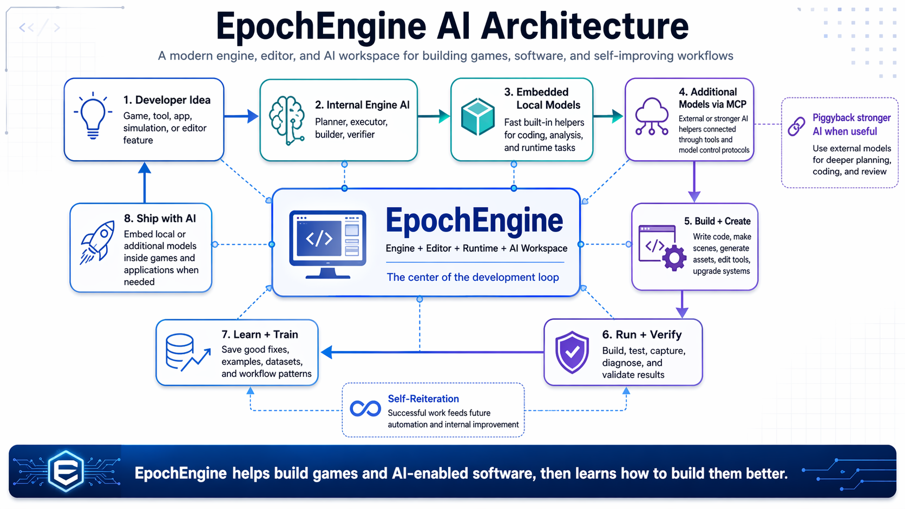

# Adam Rushford · @Autodidac

[YouTube](https://youtube.com/@adamrushford) · [GitHub](https://github.com/Autodidac) · [Frontend toy projects](https://Autodidac.github.io)

---

## C++23 Engine Architect / Graphics Programmer / AI-Enabled Software Developer

I’m building **EpochEngine**, a C++23 engine, editor, and runtime for making games, tools, editors, simulations, pipelines, and AI-enabled applications. Project creation, automation, and AI-assisted development are part of the same codebase.

---

## EpochEngine AI Architecture

The engine, editor, and runtime connect local and embedded models, external MCP tools, and verification. **Build the project, test it, learn from the results, and improve the engine.**

View the EpochEngine AI architecture diagram

---

## Main Project

### [EpochEngine](https://github.com/Autodidac/EpochEngine)

EpochEngine is the flagship. It supports editor-driven authoring, project generation and execution, multiple renderers, and procedural and time-based simulation across Windows and Linux.

- **Public downloads** · [Source v0.91.07](https://github.com/Autodidac/EpochEngine/releases/tag/v0.91.07) · [Windows and Linux runtime v0.91.05](https://github.com/Autodidac/EpochEngine/releases/tag/v0.91.05) · [Project site](https://epoch.adamrushford.chatgpt.site/projects/epoch-engine#releases)
- **Editor workflows** · 3D scenes, 2D tile maps and UI layouts, timeline playback, project build and run, and asset generation through supported local backends.
- **Optional tools** · Planetary Terrain, Plant Lab and Forest Factory, and FFT ocean. The Project Assistant offers optional guidance and reviewed project actions.

---

## What Epoch Is Becoming

A modules-first engine, real-time renderer, and game framework with an editor, project generator, simulation, and procedural content tools. The same platform aims to build and verify real software and games, host embedded local models, and connect specialized local or external helpers through MCP.

---

## AI Self-Iteration Direction

The goal is for Epoch to help build Epoch. The Development workflow brings coding, refactoring, debugging, and engine-aware task execution into the editor alongside builds, runtime launches, and checks based on screenshots, logs, and artifacts. Successful fixes and workflows can be reviewed before promotion, and reviewed development output can inform future training. Local models can handle specialized editor and runtime tasks, while external helpers can assist with planning, coding, review, assets, and automation. Embedded models in generated games and apps are part of that direction. The Public edition provides project assistance and optional inference. [Edition overview](https://github.com/Autodidac/EpochEngine#readme)

---

## Why Epoch Is Different

Unreal, Unity, and Godot are proven engines built around established editor, asset pipeline, scripting, and plugin workflows. Epoch brings C++23 scripting compiled with the engine or project, generated project shells, build tools, runtime captures, diagnostics, and AI-assisted verification into one workflow. The engine can eventually use those results to inspect and improve its own tools.

---

## Current Focus

- Stabilize the editor, launcher, windowing, and rendering across supported backends, including multicontext tooling.
- Improve asset, shader, GUI, and generated project workflows. Expand game-facing systems and runtime project support.
- Connect local and external AI tools to build, test, and verification workflows. Develop embedded model support while keeping the engine fast, modular, and maintainable.

---

## Supporting Work

My earlier procedural generation, voxel engine, Vulkan, Win32, C++ utility, template, and local AI/MCP experiments still feed into Epoch. Related projects include [EpochPlatformEngine](https://github.com/Autodidac/EpochPlatformEngine), [EpochGui](https://github.com/Autodidac/EpochGui), and [EngCoder](https://github.com/Autodidac/EngCoder).

---

## Development Goal

Build a cross-platform engine that helps create, test, automate, improve, and ship games, tools, editors, simulations, procedural systems, and AI-enabled applications, including projects generated at runtime.

---

## Follow the Build

I’m documenting the two-year EpochEngine build on YouTube and growing the engine, tooling, demos, and community in public. [YouTube](https://youtube.com/@adamrushford) · [EpochEngine](https://github.com/Autodidac/EpochEngine)

---

## Connect

Contributions, feedback, testing, and collaboration are welcome. [GitHub](https://github.com/Autodidac) · [YouTube](https://youtube.com/@adamrushford) · [Frontend toy projects](https://Autodidac.github.io)
